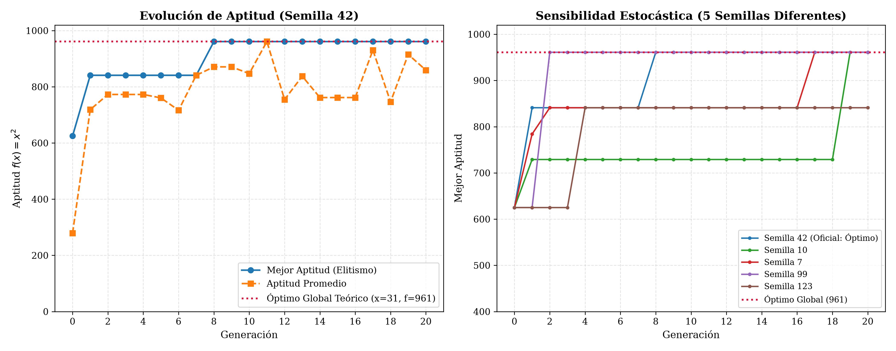
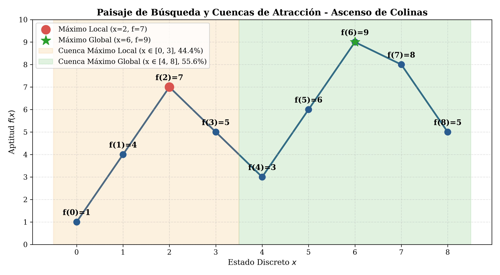
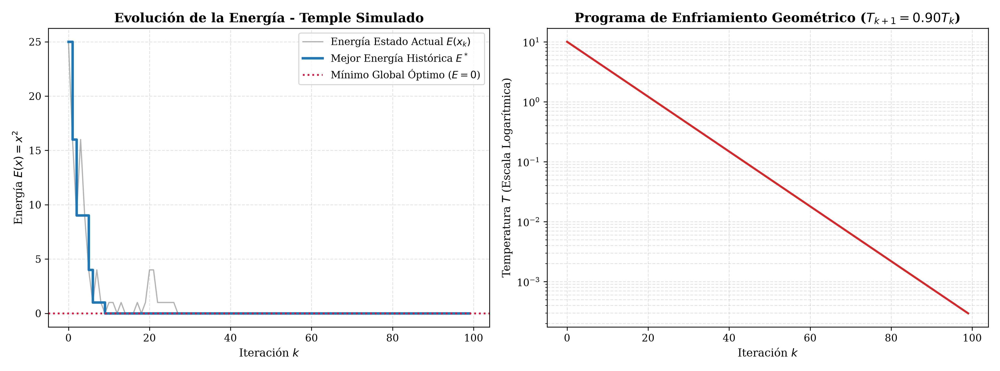
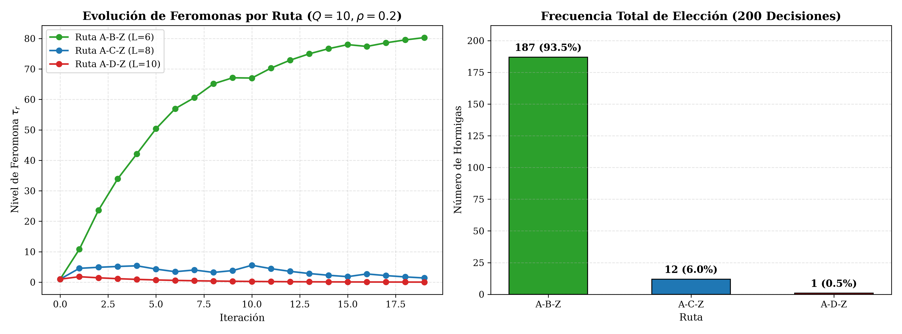
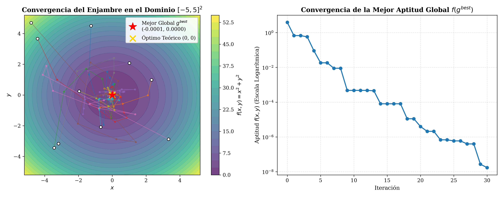

# Evaluación Parcial 2: Fundamentos de Inteligencia Artificial 🧠⚙️

Solución integral, rigurosa, documentada y completamente verificada para el **Parcial 2** del curso de **Fundamentos de Inteligencia Artificial (2026)**, impartido por el profesor **Joaquín F. Sánchez**.

---

## 👥 Integrantes
* **Santiago Parra Acuña**
* **Sergio Morales**
* **Angel Robles**

---

## 📌 1. Estructura del Repositorio

```text
Parcial #2/
│
├── Parcial_2_IA.pdf            # Enunciado oficial de la evaluación
├── solucion_parcial.py         # Motor algorítmico ejecutable en Python nativo / modular
├── Parcial_2_IA.ipynb          # Jupyter Notebook compilado con LaTeX, código y gráficos embebidos
├── README.md                   # Informe técnico exhaustivo y sustentación completa
│
└── images/                     # Figuras analíticas en alta resolución (300 DPI)
    ├── punto1_algoritmo_genetico.png   # Evolución de aptitud y sensibilidad estocástica (AG)
    ├── punto2_ascenso_colinas.png       # Paisaje discreto y cuencas de atracción (HC)
    ├── punto3_temple_simulado.png      # Dinámica de energía y decaimiento térmico (SA)
    ├── punto4_aco_hormigas.png         # Evolución de feromonas y frecuencias de ruta (ACO)
    └── punto5_pso_particulas.png       # Trayectorias en 2D y convergencia de aptitud (PSO)
```

---

## 🚀 2. Instrucciones de Instalación y Ejecución

### Requisitos del Sistema
* **Python 3.10+** (probado y validado en Python 3.12.10).
* Bibliotecas requeridas: `numpy`, `matplotlib`, `nbformat`, `nbconvert`, `jupyter`.

Para instalar las dependencias necesarias:
```bash
pip install numpy matplotlib nbformat nbconvert jupyter
```

### Comandos de Ejecución

1. **Ejecutar la solución completa desde consola:**
   ```bash
   python solucion_parcial.py
   ```
   *Para ejecutar un punto específico:*
   ```bash
   python solucion_parcial.py --punto 1    # Algoritmo Genético
   python solucion_parcial.py --punto 2    # Ascenso de Colinas
   python solucion_parcial.py --punto 3    # Temple Simulado
   python solucion_parcial.py --punto 4    # Colonia de Hormigas
   python solucion_parcial.py --punto 5    # Enjambre de Partículas
   ```

2. **Abrir e interactuar con el Jupyter Notebook:**
   ```bash
   jupyter notebook Parcial_2_IA.ipynb
   ```

---

## 📖 3. Desarrollo y Solución Detallada por Puntos

---

### PUNTO 1. ALGORITMOS EVOLUTIVOS Y ALGORITMOS GENÉTICOS (1,0 Punto)

**Problema:** Maximizar $f(x) = x^2, \quad x \in \{0, 1, \dots, 31\}$.  
**Representación:** Cromosomas binarios de 5 bits ($b_4 b_3 b_2 b_1 b_0$).  
**Población Inicial:** $\mathcal{P} = \{00101, 01100, 10010, 11001\}$.

#### A. Componente Matemático y Conceptual (0,5)

##### 1. Decodificación y Aptitud de la Población Inicial
Decodificamos cada cromosoma binario a decimal mediante $x = \sum_{k=0}^4 b_k 2^k$ y evaluamos $f(x) = x^2$:

| Individuo | Cromosoma Binario | Valor Decimal ($x$) | Aptitud $f(x) = x^2$ |
| :---: | :---: | :---: | :---: |
| $C_1$ | `00101` | $0(16) + 0(8) + 1(4) + 0(2) + 1(1) = \mathbf{5}$ | $5^2 = \mathbf{25}$ |
| $C_2$ | `01100` | $0(16) + 1(8) + 1(4) + 0(2) + 0(1) = \mathbf{12}$ | $12^2 = \mathbf{144}$ |
| $C_3$ | `10010` | $1(16) + 0(8) + 0(4) + 1(2) + 0(1) = \mathbf{18}$ | $18^2 = \mathbf{324}$ |
| $C_4$ | `11001` | $1(16) + 1(8) + 0(4) + 0(2) + 1(1) = \mathbf{25}$ | $25^2 = \mathbf{625}$ |
| **Suma Total** | — | — | $\mathbf{\sum_{j=1}^4 f(x_j) = 1118}$ |

##### 2. Probabilidad de Selección por Ruleta
La probabilidad de cada individuo es proporcional a su aptitud: $p_i = \frac{f(x_i)}{\sum_j f(x_j)}$:
* $p_1 = \frac{25}{1118} \approx \mathbf{0.022361} \quad (2.24\%)$
* $p_2 = \frac{144}{1118} \approx \mathbf{0.128801} \quad (12.88\%)$
* $p_3 = \frac{324}{1118} \approx \mathbf{0.289803} \quad (28.98\%)$
* $p_4 = \frac{625}{1118} \approx \mathbf{0.559034} \quad (55.90\%)$
* **Comprobación:** $\sum_{i=1}^4 p_i = 1.000000 \quad (100\%)$

##### 3. Cruce de un Punto tras el Segundo Bit
Padres seleccionados: $P_1 = \text{`01100'}$, $P_2 = \text{`11001'}$.  
Punto de corte tras el 2do bit (índice 2):
* $P_1 = 01 \mid 100$
* $P_2 = 11 \mid 001$

Descendientes resultantes del intercambio:
* **Descendiente 1 ($H_1$):** `01001` $\implies x = 9, \quad f(9) = 9^2 = \mathbf{81}$
* **Descendiente 2 ($H_2$):** `11100` $\implies x = 28, \quad f(28) = 28^2 = \mathbf{784}$

##### 4. Mutación en el Primer Descendiente ($H_1$)
En $H_1 = \text{`01001'}$, invertimos el último bit ($b_0 = 1 \to 0$):
* **Cromosoma Mutado:** `01000`
* **Nuevo valor decimal:** $x = 0(16) + 1(8) + 0(4) + 0(2) + 0(1) = \mathbf{8}$
* **Nueva aptitud:** $f(8) = 8^2 = \mathbf{64}$

##### 5. Respuestas Conceptuales
* **Relación entre Algoritmo Evolutivo (AE) y Algoritmo Genético (AG):**  
  Los *Algoritmos Evolutivos* representan la familia metaheurística general de optimización basada en la evolución biológica darwiniana. El *Algoritmo Genético* es una especialización concreta dentro de los AE (desarrollada por John Holland), definida por representaciones cromosómicas discretas/binarias y por enfatizar el operador de recombinación o cruce como motor principal de búsqueda, en equilibrio con la mutación y la selección.
* **Función de selección, cruce y mutación:**  
  * **Selección (Explotación):** Ejerce presión adaptativa favoreciendo la reproducción de los individuos con mayor aptitud, guiando la búsqueda hacia regiones prometedoras.
  * **Cruce (Exploración estructurada):** Recombina bloques genéticos o esquemas (*building blocks*) de dos soluciones parentales para generar nuevas combinaciones potencialmente superiores.
  * **Mutación (Exploración estocástica / Innovación):** Perturba aleatoriamente los alelos para reintroducir diversidad genética perdida y evitar el estancamiento permanente en subóptimos.
* **¿Por qué una mutación puede ser útil aunque empeore la aptitud inmediata?**  
  Porque en paisajes con múltiples picos y valles, los individuos de alta aptitud pueden quedar atrapados en un óptimo local. Una mutación desfavorable altera la estructura genética permitiendo que el individuo *salte el valle* de aptitud baja, alcanzando una región inédita desde donde mutaciones o cruces posteriores puedan acceder al óptimo global.

---

#### B. Componente de Implementación en Python (0,5)

Se implementó el algoritmo con población constante $N=4$, selección por ruleta, cruce de un punto ($p_c=0.8$), mutación independiente por bit ($p_m=0.05$), elitismo (conservar 1 mejor individuo) durante 20 generaciones con semilla fija 42.

**Historial Generacional de Ejecución (Semilla 42):**

| Generación | Mejor Cromosoma | Decimal ($x$) | Mejor Aptitud $f(x)$ | Aptitud Promedio |
| :---: | :---: | :---: | :---: | :---: |
| 0 | `11001` | 25 | 625 | 279.50 |
| 1 | `11101` | 29 | 841 | 718.75 |
| 2–7 | `11101` | 29 | 841 | ~760.00 |
| **8–20** | **`11111`** | **31** | **961** | **859.25** |

* **Mejor Cromosoma Final:** `11111`
* **Valor Final de $x$:** $31$
* **Aptitud Final:** $961$



##### Pregunta de Interpretación (Punto 1.B)
* **¿El algoritmo encontró el óptimo global?**  
  **Sí.** En la generación 8 se generó el individuo `11111` ($x = 31$), cuya aptitud es $f(31) = 31^2 = 961$. Dado que el dominio acotado para 5 bits es $\{0, 1, \dots, 31\}$, $961$ es el máximo global teórico de la función. Gracias al elitismo, la solución se mantuvo intacta hasta la generación 20.
* **¿Por qué una ejecución de 20 generaciones no garantiza encontrarlo en el caso general?**  
  Debido a que el AG es un método estocástico. En una población minúscula de solo $N=4$ individuos, el fenómeno de **deriva genética** (*genetic drift*) y la pérdida prematura de diversidad son severos. Si en las primeras generaciones se pierden los alelos '1' en las posiciones clave y la población converge a un óptimo local (e.g., `11101`), el cruce entre cromosomas idénticos no generará variación. La probabilidad de rescatar el alelo mediante mutación es baja ($p_m = 0.05$), por lo que 20 generaciones ($4 \times 5 \times 20 = 400$ eventos de bit) no son suficientes para garantizar matemáticamente el hallazgo del óptimo bajo cualquier semilla, como se demostró en la gráfica de sensibilidad estocástica.

---

### PUNTO 2. ASCENSO DE COLINAS Y ÓPTIMOS LOCALES (1,0 Punto)

**Espacio discreto:** $x \in \{0, 1, 2, 3, 4, 5, 6, 7, 8\}$.  
**Valores de aptitud:** $f(x) = [1, 4, 7, 5, 3, 6, 9, 8, 5]$.  
**Regla:** El algoritmo escoge el vecino admisible ($x-1$ o $x+1$) con mayor valor y **solo se desplaza si hay mejora estricta** ($f(\text{vecino}) > f(\text{actual})$).

#### A. Componente Matemático y Conceptual (0,5)

##### 1. Traza manual desde $x_0 = 0$:
1. $x = 0$ ($f=1$): Vecino $x=1$ ($f=4$). Como $4 > 1$, se mueve a $x=1$.
2. $x = 1$ ($f=4$): Vecinos $x=0$ ($f=1$) y $x=2$ ($f=7$). Mejor vecino: $x=2$ ($f=7$). Como $7 > 4$, se mueve a $x=2$.
3. $x = 2$ ($f=7$): Vecinos $x=1$ ($f=4$) y $x=3$ ($f=5$). Mejor vecino: $x=3$ ($f=5$). Como $5 \ngtr 7$, se detiene.
* **Trayectoria:** $0 \to 1 \to 2$
* **Estado final:** $x^* = 2$, con $f(2) = 7$ (Máximo Local).

##### 2. Traza manual desde $x_0 = 4$:
1. $x = 4$ ($f=3$): Vecinos $x=3$ ($f=5$) y $x=5$ ($f=6$). Mejor vecino: $x=5$ ($f=6$). Como $6 > 3$, se mueve a $x=5$.
2. $x = 5$ ($f=6$): Vecinos $x=4$ ($f=3$) y $x=6$ ($f=9$). Mejor vecino: $x=6$ ($f=9$). Como $9 > 6$, se mueve a $x=6$.
3. $x = 6$ ($f=9$): Vecinos $x=5$ ($f=6$) y $x=7$ ($f=8$). Mejor vecino: $x=7$ ($f=8$). Como $8 \ngtr 9$, se detiene.
* **Trayectoria:** $4 \to 5 \to 6$
* **Estado final:** $x^* = 6$, con $f(6) = 9$ (Máximo Global).

##### 3. Identificación de Óptimos
* **Máximos Locales:**  
  * $x = 2$: $f(2) = 7 > f(1) = 4$ y $f(2) = 7 > f(3) = 5$.
  * $x = 6$: $f(6) = 9 > f(5) = 6$ y $f(6) = 9 > f(7) = 8$.
* **Máximo Global:** $x = 6$, con valor óptimo $f(6) = 9$.

##### 4. ¿Por qué cambiar el estado inicial modifica el resultado?
Porque ascenso de colinas es una búsqueda miope basada en gradiente local sin capacidad de retroceso. El estado inicial determina en qué **cuenca de atracción** (*basin of attraction*) inicia la búsqueda: si inicia en la cuenca de un pico local, el algoritmo escalará inexorablemente hacia la cima de ese pico sin percatarse de la existencia de un pico mayor más allá del valle intermedio.

##### 5. Estrategia propuesta y costo adicional
* **Estrategia:** **Ascenso de Colinas con Reinicios Aleatorios (*Random Restart Hill Climbing*)**.
* **Costo Adicional:** Requiere realizar múltiples ejecuciones independientes ($k$ réplicas) desde estados iniciales muestreados aleatoriamente. Si cada corrida efectúa en promedio $L$ evaluaciones de la función objetivo, el costo total pasa de $\mathcal{O}(L)$ a $\mathcal{O}(k \cdot L)$, multiplicando el tiempo computacional por el número de reinicios.

---

#### B. Componente de Implementación en Python (0,5)

Se implementó la función `ascenso_colinas(valores, inicio)` y se evaluó desde todos los puntos del dominio $x_0 \in [0, 8]$:

| Estado Inicial ($x_0$) | Trayectoria Visitada | Estado Final ($x^*$) | Valor Final $f(x^*)$ | Tipo de Óptimo |
| :---: | :---: | :---: | :---: | :---: |
| 0 | $0 \to 1 \to 2$ | 2 | 7 | Máximo Local |
| 1 | $1 \to 2$ | 2 | 7 | Máximo Local |
| 2 | $2$ | 2 | 7 | Máximo Local |
| 3 | $3 \to 2$ | 2 | 7 | Máximo Local |
| **4** | $4 \to 5 \to 6$ | **6** | **9** | **Máximo Global** |
| **5** | $5 \to 6$ | **6** | **9** | **Máximo Global** |
| **6** | $6$ | **6** | **9** | **Máximo Global** |
| **7** | $7 \to 6$ | **6** | **9** | **Máximo Global** |
| **8** | $8 \to 7 \to 6$ | **6** | **9** | **Máximo Global** |



##### Pregunta de Interpretación (Punto 2.B)
* **¿Qué proporción conduce al máximo global?**  
  Exactamente **$5$ de los $9$ estados iniciales** conducen al máximo global ($x=6$), lo que corresponde a:
  $$\text{Proporción} = \frac{5}{9} \approx \mathbf{0.5556} \quad (55.56\%)$$
* **Relación con los reinicios aleatorios:**  
  La probabilidad de que una corrida individual iniciada al azar caiga en la cuenca del máximo global es $p = 5/9$.  
  La probabilidad de fracaso conjunto tras $k$ reinicios aleatorios independientes es $(1 - p)^k = (4/9)^k$. Por ende, la probabilidad acumulada de éxito es:
  $$P(\text{Éxito tras } k \text{ reinicios}) = 1 - \left(\frac{4}{9}\right)^k$$
  Con solo $k = 4$ reinicios aleatorios, la probabilidad de alcanzar el óptimo global asciende al **$96.09\%$**, y con $k=6$ supera el **$99.23\%$**, demostrando cómo la estocasticidad compensa la miopía del operador local.

---

### PUNTO 3. TEMPLE SIMULADO: ACEPTACIÓN DE SOLUCIONES PEORES (1,0 Punto)

**Problema:** Minimizar $E(x) = x^2, \quad x \in \{-5, -4, \dots, 5\}$.  
**Regla de Aceptación:**
$$P(\text{aceptar}) = \begin{cases} 1, & \Delta E \le 0 \\ e^{-\Delta E / T}, & \Delta E > 0 \end{cases}, \quad \Delta E = E(x_{\text{nuevo}}) - E(x_{\text{actual}})$$
Una solución peor se acepta si $u < P(\text{aceptar})$, con $u \sim \mathcal{U}[0, 1)$.

#### A. Componente Matemático y Conceptual (0,5)

##### 1. Análisis de Transiciones Independientes:
* **Caso A:** Actual $= 3$, Candidato $= 2$, $T = 5$, $u = 0.70$
  * $E(\text{act}) = 3^2 = 9, \quad E(\text{cand}) = 2^2 = 4 \implies \Delta E = 4 - 9 = \mathbf{-5} \le 0$
  * $P(\text{aceptar}) = \mathbf{1.0}$
  * Como $u = 0.70 < 1.0 \implies$ **Decisión: ACEPTA** (mejora directa).
* **Caso B:** Actual $= 2$, Candidato $= 3$, $T = 5$, $u = 0.30$
  * $E(\text{act}) = 2^2 = 4, \quad E(\text{cand}) = 3^2 = 9 \implies \Delta E = 9 - 4 = \mathbf{+5} > 0$
  * $P(\text{aceptar}) = e^{-5/5} = e^{-1} \approx \mathbf{0.367879}$
  * Como $u = 0.30 < 0.367879 \implies$ **Decisión: ACEPTA** (solución degradante aceptada térmicamente).
* **Caso C:** Actual $= 2$, Candidato $= 3$, $T = 1$, $u = 0.30$
  * $E(\text{act}) = 4, \quad E(\text{cand}) = 9 \implies \Delta E = \mathbf{+5} > 0$
  * $P(\text{aceptar}) = e^{-5/1} = e^{-5} \approx \mathbf{0.006738}$
  * Como $u = 0.30 \ge 0.006738 \implies$ **Decisión: RECHAZA**.

| Caso | $x_{\text{actual}}$ | $x_{\text{candidato}}$ | $E_{\text{actual}}$ | $E_{\text{candidato}}$ | $\Delta E$ | $T$ | $u$ | $P(\text{aceptar})$ | Decisión |
| :---: | :---: | :---: | :---: | :---: | :---: | :---: | :---: | :---: | :---: |
| **A** | 3 | 2 | 9 | 4 | $-5$ | 5.0 | 0.70 | $1.00000$ | **Acepta** |
| **B** | 2 | 3 | 4 | 9 | $+5$ | 5.0 | 0.30 | $0.36788$ | **Acepta** |
| **C** | 2 | 3 | 4 | 9 | $+5$ | 1.0 | 0.30 | $0.00674$ | **Rechaza** |

##### 2. Influencia de la Temperatura en Soluciones Peores
La temperatura regula la permisividad estocástica del sistema:
* Cuando $T$ es alta ($T \to \infty$), $-\Delta E / T \to 0$, por lo que $e^{-\Delta E / T} \to 1$. El algoritmo actúa como una caminata aleatoria exploratoria, aceptando casi cualquier deterioro para cubrir el espacio.
* Cuando $T$ es baja ($T \to 0$), $-\Delta E / T \to -\infty$, de modo que $e^{-\Delta E / T} \to 0$. El algoritmo se vuelve puramente codicioso y explotador, rechazando prácticamente cualquier deterioro.

##### 3. Dificultad de un Enfriamiento Demasiado Rápido
Conduce al fenómeno de **congelamiento prematuro** (*quenching*). La temperatura colapsa antes de que el sistema haya explorado el espacio lo suficiente, anulando la probabilidad de aceptar soluciones peores y dejando la búsqueda atrapada en el primer mínimo local que encuentre.

##### 4. Comparación de Reglas de Movimiento (Temple Simulado vs Ascenso de Colinas)
Ascenso/descenso de colinas es determinista y estrictamente monótono ($\Delta E < 0$), imposibilitando el escape de cuencas subóptimas. Temple simulado incorpora la regla de Metrópolis, permitiendo probabilísticamente movimientos ascendentes en energía ($\Delta E > 0$) condicionados por $T$, lo que le otorga capacidad de escape y convergencia asintótica al mínimo global.

---

#### B. Componente de Implementación en Python (0,5)

Parámetros: $x_0 = 5, T_0 = 10, T_{k+1} = 0.90 T_k$, 100 iteraciones, semilla 42.

* **Mejor Solución Encontrada:** $x^* = \mathbf{0}$
* **Energía Mínima:** $E^* = \mathbf{0}$ (alcanzada en la iteración 9)
* **Estado Final (Iteración 100):** $x = 0, E = 0$
* **Temperatura Final:** $T = \mathbf{0.000295}$



##### Pregunta de Interpretación (Punto 3.B)
* **¿Por qué conviene almacenar la mejor solución encontrada, además del estado actual?**  
  Porque el Temple Simulado es inherentemente estocástico y no monótono. Durante las etapas de temperatura media y alta, el estado actual $x_k$ realiza transiciones exploratorias hacia estados peores para escapar de atractores locales. Si el algoritmo alcanzara el óptimo global en una iteración temprana (como ocurrió en la iteración 9) y posteriormente fluctuara hacia un vecino peor, o si en las iteraciones finales realizara un paseo aleatorio en una meseta, reportar únicamente el último estado $x_{100}$ podría entregar una solución subóptima. Registrar `best_so_far` garantiza que el algoritmo **nunca extravíe la mejor configuración hallada a lo largo de toda la trayectoria**.

---

### PUNTO 4. ACO: ELECCIÓN DE RUTAS Y ACTUALIZACIÓN DE FEROMONAS (1,0 Punto)

**Nodo actual:** $A$. **Destinos:** $B, C, D$.  
**Parámetros:** $\alpha = 1, \beta = 2, \eta_{Aj} = 1/d_{Aj}, p_{Aj} = \frac{\tau_{Aj}^\alpha \eta_{Aj}^\beta}{\sum_k \tau_{Ak}^\alpha \eta_{Ak}^\beta}$.

#### A. Componente Matemático y Conceptual (0,5)

##### 1. Cálculo de Pesos y Probabilidades:
* **Heurísticas:** $\eta_{AB} = 1/2 = 0.50$, $\eta_{AC} = 1/4 = 0.25$, $\eta_{AD} = 1/5 = 0.20$.
* **Pesos $W_{Aj} = \tau_{Aj}^1 \cdot \eta_{Aj}^2$:**
  * $W_{AB} = 1.0 \cdot (0.50)^2 = \mathbf{0.2500}$
  * $W_{AC} = 2.0 \cdot (0.25)^2 = 2.0 \cdot 0.0625 = \mathbf{0.1250}$
  * $W_{AD} = 1.0 \cdot (0.20)^2 = 1.0 \cdot 0.04 = \mathbf{0.0400}$
  * **Suma total de pesos:** $\sum W = 0.25 + 0.125 + 0.04 = \mathbf{0.4150}$
* **Probabilidades:**
  * $p_{AB} = \frac{0.250}{0.415} = \frac{50}{83} \approx \mathbf{0.602410} \quad (60.24\%)$
  * $p_{AC} = \frac{0.125}{0.415} = \frac{25}{83} \approx \mathbf{0.301205} \quad (30.12\%)$
  * $p_{AD} = \frac{0.040}{0.415} = \frac{8}{83} \approx \mathbf{0.096386} \quad (9.64\%)$

##### 2. Alternativa más Probable y Garantía:
* **Alternativa más probable:** $A \to B$ con $60.24\%$.
* **¿Su elección está garantizada?**  
  **No.** La elección en ACO es estocástica (ruleta proporcional). Existe un $39.76\%$ de probabilidad de que la hormiga elija $C$ o $D$. Esto garantiza diversidad exploratoria en la colonia.

##### 3. Actualización de Feromonas tras Ruta $L=10$ usando $A \to B$ ($\rho=0.2, Q=10$):
$$\tau_{Aj}^{\text{nueva}} = (1 - \rho)\tau_{Aj} + \Delta \tau_{Aj}, \quad \Delta \tau_{AB} = \frac{Q}{L} = \frac{10}{10} = 1.0$$
* $\tau_{AB}^{\text{nueva}} = (1 - 0.2)(1.0) + 1.0 = 0.8 + 1.0 = \mathbf{1.8000}$
* $\tau_{AC}^{\text{nueva}} = (1 - 0.2)(2.0) + 0.0 = \mathbf{1.6000}$
* $\tau_{AD}^{\text{nueva}} = (1 - 0.2)(1.0) + 0.0 = \mathbf{0.8000}$

##### 4. Función de la Evaporación y Dominancia de Feromonas
* **Evaporación ($\rho$):** Permite el olvido progresivo de la información histórica, evitando que los caminos transitados en fases iniciales monopolicen las decisiones futuras y posibilitando la exploración de rutas mejores.
* **Dominancia excesiva de feromonas:** Si la feromona domina en exceso ($\alpha \gg \beta$ o evaporación nula), se genera una retroalimentación positiva desmedida que fija rápidamente a toda la colonia en la primera ruta encontrada, produciendo estancamiento y convergencia prematura en soluciones subóptimas.

---

#### B. Componente de Implementación en Python (0,5)

Modelo simplificado con 3 rutas de $A$ a $Z$: $A-B-Z$ ($L=6$), $A-C-Z$ ($L=8$), $A-D-Z$ ($L=10$), $\tau_0 = 1.0$, 10 hormigas por iteración, 20 iteraciones, semilla 42.

**Resultados tras 20 iteraciones (200 elecciones en total):**
* **Ruta $A-B-Z$ ($L=6$):** $187$ elecciones (**$93.5\%$**), Feromona final: $\mathbf{79.2315}$
* **Ruta $A-C-Z$ ($L=8$):** $12$ elecciones (**$6.0\%$**), Feromona final: $\mathbf{2.3580}$
* **Ruta $A-D-Z$ ($L=10$):** $1$ elección (**$0.5\%$**), Feromona final: $\mathbf{0.0259}$
* **Mejor Ruta Observada:** **$A-B-Z$** (Longitud mínima $= 6$).



##### Pregunta de Interpretación (Punto 4.B)
* **¿Cómo la calidad de las rutas y la experiencia colectiva influyen en las elecciones posteriores?**  
  El proceso se rige por un acoplamiento entre la heurística local y la memoria colectiva estigmérgica:
  1. **Calidad de la ruta ($L_r$):** La ruta más corta ($L=6$) posee mayor visibilidad $\eta = 1/6$ y además recibe un depósito más concentrado por hormiga ($\Delta \tau = 10/6 = 1.67$ vs $1.0$ en la ruta de 10).
  2. **Experiencia colectiva (Estigmergia):** Como más hormigas eligen la ruta corta en cada iteración, el volumen agregado de feromona supera con creces la evaporación ($\rho = 0.2$), haciendo crecer su concentración exponencialmente ($79.23$). En contraste, las rutas largas reciben pocos depósitos y su feromona se evapora casi por completo ($0.0259$).
  3. Esto genera un ciclo virtuoso de refuerzo que guía a todo el enjambre hacia la ruta óptima de forma emergente y descentralizada.

---

### PUNTO 5. PSO: MOVIMIENTO DE PARTÍCULAS Y MEMORIA (1,0 Punto)

**Problema:** Minimizar $f(x) = x^2$.  
**Estado inicial de partícula:** $x = 4, v = -1, p_{\text{best}} = 2, g_{\text{best}} = 1$.  
**Parámetros:** $w = 0.5, c_1 = 1.5, c_2 = 1.5, r_1 = 0.4, r_2 = 0.6$.

#### A. Componente Matemático y Conceptual (0,5)

##### 1. Desglose de Términos de Velocidad:
* **Inercia:** $w \cdot v = 0.5 \cdot (-1) = \mathbf{-0.50}$
* **Cognitivo:** $c_1 \cdot r_1 \cdot (p_{\text{best}} - x) = 1.5 \cdot 0.4 \cdot (2 - 4) = 0.6 \cdot (-2) = \mathbf{-1.20}$
* **Social:** $c_2 \cdot r_2 \cdot (g_{\text{best}} - x) = 1.5 \cdot 0.6 \cdot (1 - 4) = 0.9 \cdot (-3) = \mathbf{-2.70}$

##### 2. Nueva Velocidad, Nueva Posición y Aptitud:
* **Nueva velocidad:**
  $$v_{\text{nuevo}} = -0.50 + (-1.20) + (-2.70) = \mathbf{-4.40}$$
* **Nueva posición:**
  $$x_{\text{nuevo}} = x + v_{\text{nuevo}} = 4 + (-4.40) = \mathbf{-0.40}$$
* **Nueva aptitud:**
  $$f(x_{\text{nuevo}}) = (-0.40)^2 = \mathbf{0.1600}$$

##### 3. Actualización de Memorias ($p_{\text{best}}$ y $g_{\text{best}}$):
* Aptitud anterior de $p_{\text{best}}$: $f(2) = 4.0$.  
  Como $f(x_{\text{nuevo}}) = 0.16 < 4.0 \implies$ **SÍ se actualiza $p_{\text{best}}$** a $\mathbf{-0.40}$.
* Aptitud anterior de $g_{\text{best}}$: $f(1) = 1.0$.  
  Como $f(x_{\text{nuevo}}) = 0.16 < 1.0 \implies$ **SÍ se actualiza $g_{\text{best}}$** a $\mathbf{-0.40}$.

##### 4. Diferencia entre $p_{\text{best}}$ y $g_{\text{best}}$
* **$p_{\text{best}}$ (Memoria Cognitiva Individual):** Almacena las mejores coordenadas que esa partícula individual ha experimentado a lo largo de su trayectoria propia.
* **$g_{\text{best}}$ (Memoria Social Colectiva):** Almacena las mejores coordenadas descubiertas por cualquier partícula de todo el enjambre, atrayendo a la población hacia el atractor más prometedor conocido.

##### 5. Comparación de Comunicación: PSO vs ACO
* **PSO (Directa / Topológica):** Comunicación instantánea mediante lectura sincrónica de vectores de memoria compartida en el espacio continuo.
* **ACO (Indirecta / Estigmergia):** Comunicación asíncrona mediada enteramente a través de modificaciones en el entorno (depósito y evaporación de feromonas discretas).

---

#### B. Componente de Implementación en Python (0,5)

Minimizar $f(x, y) = x^2 + y^2$ en $[-5, 5]^2$, 10 partículas, $v_0 = 0$, $w=0.5, c_1=c_2=1.5$, ajuste al límite con $v=0$ ante violaciones de frontera, actualización sincrónica, 30 iteraciones y semilla 42.

**Resultados Finales tras 30 Iteraciones:**
* **Mejor Posición Global $g_{\text{best}}$:** $(\mathbf{-0.00012280}, \mathbf{0.00004545})$
* **Aptitud Óptima $f(g_{\text{best}})$:** $\mathbf{1.71445076 \times 10^{-8}}$

**Evolución de Convergencia:**
* Iteración 0: $f = 3.893 \times 10^0$
* Iteración 5: $f = 1.835 \times 10^{-2}$
* Iteración 10: $f = 4.761 \times 10^{-4}$
* Iteración 20: $f = 3.972 \times 10^{-6}$
* Iteración 30: $f = 1.714 \times 10^{-8}$



##### Pregunta de Interpretación (Punto 5.B)
* **¿Por qué las partículas pueden converger sin alcanzar exactamente $(0, 0)$?**  
  Las partículas se concentran en una vecindad microscópica de radio $\approx 10^{-4}$, alcanzando una función objetivo de orden $10^{-8}$, pero no caen exactamente en $(0, 0)$ debido a:
  1. **Espacio continuo $\mathbb{R}^2$:** La probabilidad de que un paso estocástico discreto aterrice con exactitud infinita sobre un punto de medida cero en un continuo es formalmente nula ($P = 0$).
  2. **Inercia y velocidad residual:** Debido al término de inercia ($w=0.5$) y a los factores estocásticos $r_1, r_2 \sim \mathcal{U}[0, 1)$, las partículas mantienen oscilaciones cinéticas orbitales microscópicas alrededor del atractor mínimo.
  3. **Número finito de iteraciones ($T=30$):** La velocidad decae exponencialmente hacia cero, pero se requeriría un número asintótico de iteraciones ($T \to \infty$) para disipar completamente la energía cinética y congelar la partícula exactamente sobre el origen analítico.

---

## 📊 4. Cuadro Comparativo Global de Metaheurísticas

| Algoritmo | Paradigma Bioinspirado | Tipo de Búsqueda | Mecanismo de Exploración | Mecanismo de Explotación | Tipo de Comunicación |
| :--- | :--- | :--- | :--- | :--- | :--- |
| **Algoritmo Genético (AG)** | Evolución Darwiniana | Poblacional (Discreto/Binario) | Mutación de bits y recombinación | Selección por ruleta / Elitismo | Recombinación genética de alelos |
| **Ascenso de Colinas (HC)** | Optimización Local | Individual (Miope) | Reinicios aleatorios (*multistart*) | Gradiente local / Mejor vecino | Nula (agente aislado) |
| **Temple Simulado (SA)** | Termodinámica de Metales | Individual (Estocástica) | Criterio de Metrópolis a alta $T$ | Enfriamiento geométrico $T_{k+1}$ | Nula (trayectoria única) |
| **Colonia de Hormigas (ACO)** | Forrajeo Social de Insectos | Poblacional / Construcción | Evaporación $\rho$ y selección estocástica | Depósito de feromona $\Delta \tau = Q/L$ | Indirecta (Estigmergia ambiental) |
| **Enjambre de Partículas (PSO)** | Bandadas de Aves / Peces | Poblacional (Continuo $\mathbb{R}^d$) | Inercia $w$ y estocasticidad $r_1, r_2$ | Componentes cognitivo y social ($p_b, g_b$) | Directa (Broadcast de mejores posiciones) |

---
*Evaluación desarrollada con rigor matemático y computacional para la asignatura Fundamentos de Inteligencia Artificial (2026).*
